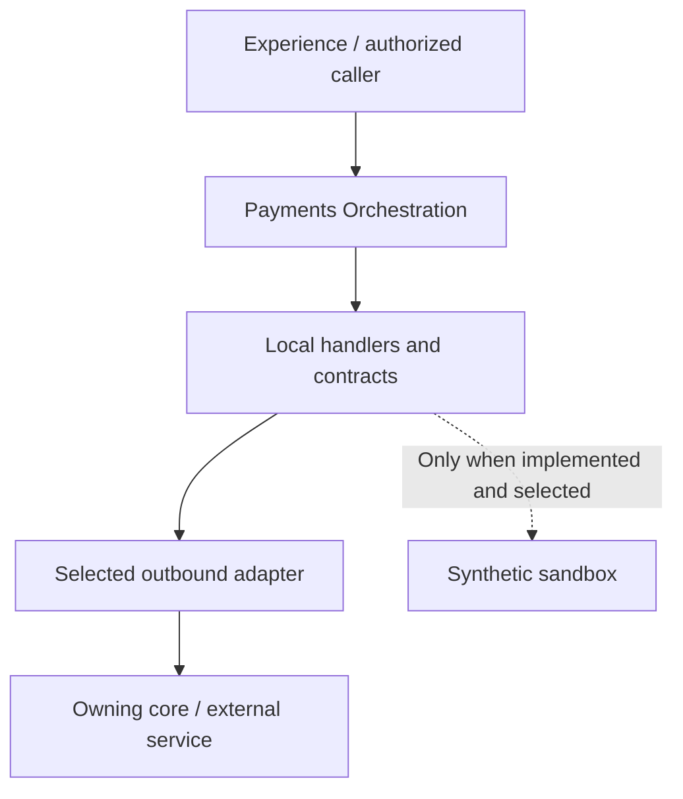

<a href="https://fireflysoftware.io/openplatform/">
<picture>
  <source media="(prefers-color-scheme: dark)" srcset="https://raw.githubusercontent.com/fireflysoftwaresolutions/.github/main/profile/assets/banner-dark.svg">
  
</picture>
</a>

# Payments Orchestration

Domain service for internal transfers, outbound disbursements, inbound collections, SCA, ledger, and rail coordination in Firefly OpenPlatform.

[Platform documentation](https://docs.fireflysoftware.io/) · [Source reference](docs/openplatform/reference.md) · [Source inventory](docs/openplatform/source-inventory.json)

## Purpose, scope, and readiness

Owns orchestration for native managed internal transfers and the separately configured legacy payment/SCA/provider routes. Native handlers use Jafly CQRS and per-invocation sagas, genuine payment-core/ledger SDKs and current actor delegation. Ledger owns financial balances/effects; payment core owns the durable instruction/effect/recovery journal.

The native five-operation managed domain has full81producer tests and independent127actual four-executable/SDK assertions against its exact frozen artifacts. It supports current authorized creation/read/decision/recovery/history and preserves original posting plus linked reversal. Experience adoption, automatic queue-only recovery and required FX/fees/overdraft/external settlement remain separate gates. Legacy synthetic provider flows do not establish settlement finality.

## Business ownership and supported journeys

Use the native managed route for an explicitly authorized enrolled-account transfer: accept immutable intent, reserve real funds, explicitly confirm or cancel, then retrieve the reconciled receipt and bounded timeline. Follow [managed journey trust, configuration and SDK guidance](docs/managed-internal-payments.md). Legacy routes retain their own documented adapter/SCA behavior.

core-banking-payments owns instruction records; the domain does not keep a second ledger. Sandbox provider success is synthetic and cannot be reported as bank or rail settlement.

| Entry point | Declared operations |
| --- | --- |
| [PaymentRecordsController](domain-payments-web/src/main/java/io/fireflysoftware/domain/payments/web/PaymentRecordsController.java) | `GET /api/v1/payment-records/standing-orders/{runId}`; `GET /api/v1/payment-records/direct-debits/{mandateId}`; `POST /api/v1/payment-records/standing-orders`; 1 more declarations |
| [PaymentsController](domain-payments-web/src/main/java/io/fireflysoftware/domain/payments/web/PaymentsController.java) | `GET /api/v1/payments/{paymentId}`; `POST /api/v1/payments/tries`; `POST /api/v1/payments/{paymentId}/confirmations`; 1 more declarations |
| [ManagedPaymentsController](domain-payments-web/src/main/java/io/fireflysoftware/domain/payments/web/managed/ManagedPaymentsController.java) | `GET /api/v1/tenants/{tenant}/internal-payments/{paymentId}`; `GET /api/v1/tenants/{tenant}/internal-payments/{paymentId}/history`; `POST /api/v1/tenants/{tenant}/internal-payments`; 2 more declarations |

The complete [operation reference](docs/openplatform/reference.md#http-operations) lists each mapping and its owning method. These are source declarations; conditional beans, inherited controllers, security filters, and deployment routing can change the effective runtime API.

## Consumer example: confirm an outbound payment with its actual challenge

Start with this repository-owned executable contract before connecting a full runtime. Use the JDK required by the effective parent, Maven, and the matching internal artifacts. The selected test defines its own collaborators; no provider credentials should be added to it. Run from this repository root:

```sh
mvn -B -pl domain-payments-core -am test -DskipOpenApiGen \
  -Dtest=PaymentTccHubTest -Dsurefire.failIfNoSpecifiedTests=false
```

Runtime integration remains gated on the service configuration and selected adapters described below. The local port and bean-selection inventory below distinguishes the declared abstraction from its configured implementation. An SDK client is an outbound integration; its presence does not establish a working provider connection. Where a sandbox adapter is selected, its behavior is synthetic and limited to what that adapter implements.

**Inputs and fixture ownership.** The complete linked test class supplies its imports, setup, synthetic IDs and collaborators. Run that class as shown; the excerpt is not a standalone Java program. Synthetic adapter data is scoped to this fixture and does not seed an external owner. For a deployed call, replace fixture IDs with IDs returned by the owning record-creation API and keep tenant/parent associations intact. The request values and assertions below describe this test boundary only.

```java
@Test
    void outboundTryConfirmAndCancelUseTheSandboxChallenge() {
        MovementResult tried = hub.tryPayment(outbound("out-1"));

        assertEquals(PaymentPhase.TRYING, tried.phase());
        assertNotNull(tried.challengeId());
        assertNotNull(tried.challengeValue());
        assertNotEquals("sandbox", tried.challengeValue());
        assertFalse(tried.thirdPartySynced());
        assertEquals(0, ledger.postings().size());
        assertTrue(ledger.holding("out-1"));
        assertEquals(0, rail.outboundCalls());

        MovementResult rejected = hub.confirm(tried.paymentId(), "sandbox");
        assertEquals(PaymentPhase.CANCELLED, rejected.phase());
        assertEquals(0, ledger.postings().size());
        assertFalse(ledger.holding("out-1"));
        assertEquals(0, rail.outboundCalls());

        MovementResult again = hub.tryPayment(outbound("out-2"));
        MovementResult confirmed = hub.confirm(again.paymentId(), again.challengeValue());
        assertEquals(PaymentPhase.CONFIRMED, confirmed.phase());
        assertTrue(confirmed.thirdPartySynced());
        assertEquals(MovementRoute.OUTBOUND_RAIL, confirmed.route());
        assertEquals(1, ledger.postings().size());
        assertEquals(EntrySide.DEBIT, confirmed.posting().legs().get(0).side());
        assertEquals(SOURCE, confirmed.posting().legs().get(0).accountId());
        assertEquals(SandboxCatalog.clearing().outboundClearingAccountId(), confirmed.posting().legs().get(1).accountId());
        assertEquals(1, rail.outboundCalls());

        MovementResult replay = hub.confirm(again.paymentId(), again.challengeValue());
        assertEquals(confirmed.paymentId(), replay.paymentId());
        assertEquals(1, ledger.postings().size());
        assertEquals(1, rail.outboundCalls());
    }
```

**Expected behavior.** TRY creates a hold and no posting. The literal sandbox response cancels and releases the hold. A new TRY confirmed with its returned challenge posts once and invokes the recording rail once; replay does not duplicate those in-memory effects.

**Verification and recovery.** Run the complete selected test class and inspect its Surefire result: zero failures/errors and at least one executed test are required. A skipped or zero-test build is not evidence. Compare the assertions with the owning DTO/service before extending the request. For a runtime run, separately configure authentication/entitlements and the exact downstream endpoints, migrate/seed disposable owner stores, and reread the returned identifier; these unit/contract fixtures do not establish those prerequisites.

**Execution evidence.** Source checked against the linked test and local declarations. The documentation worker has not run this repository test or the full service. The excerpt is retained from the existing test; mock, in-memory, or local HTTP fixture results are not live-provider acceptance.

Source of this example: [PaymentTccHubTest](domain-payments-core/src/test/java/io/fireflysoftware/domain/payments/core/tcc/PaymentTccHubTest.java), [EntrySide](domain-payments-interfaces/src/main/java/io/fireflysoftware/domain/payments/EntrySide.java), [MovementCommand](domain-payments-interfaces/src/main/java/io/fireflysoftware/domain/payments/MovementCommand.java), [MovementResult](domain-payments-interfaces/src/main/java/io/fireflysoftware/domain/payments/MovementResult.java), [MovementRoute](domain-payments-interfaces/src/main/java/io/fireflysoftware/domain/payments/MovementRoute.java), [PaymentPhase](domain-payments-interfaces/src/main/java/io/fireflysoftware/domain/payments/PaymentPhase.java), [PaymentScheme](domain-payments-interfaces/src/main/java/io/fireflysoftware/domain/payments/PaymentScheme.java), [SchemeRouter](domain-payments-core/src/main/java/io/fireflysoftware/domain/payments/core/routing/SchemeRouter.java), [SandboxCatalog](domain-payments-core/src/main/java/io/fireflysoftware/domain/payments/core/sandbox/SandboxCatalog.java).

## Architecture and repository layout



| Module | Responsibility |
| --- | --- |
| [domain-payments-interfaces](domain-payments-interfaces/) | Public DTOs, commands, queries, and contracts shared across the module boundary. |
| [domain-payments-core](domain-payments-core/) | Application services, handlers, and business coordination; inspect these implementations for lifecycle rules. |
| [domain-payments-infra](domain-payments-infra/) | Outbound clients, adapters, and client configuration for dependencies. |
| [domain-payments-web](domain-payments-web/) | HTTP entry points, boot application, and runtime configuration. |
| [domain-payments-sdk](domain-payments-sdk/) | Client artifact and OpenAPI generation configuration; build it from the matching service contract. |

## Contracts, data, authentication, and errors

Native creation returns201 for first acceptance and200 for an identical authorized replay, always with current retained state. Decisions/recovery return202 when pending or uncertain. Stable core effects and fenced claims drive the actual ledger operation; the core independently reconciles the complete original intent/deadline before retaining financial results. History is bounded, ordered and currently authorized, with original completion and distinct reversal evidence. No balance or financial journal is duplicated in the domain.

The legacy ledger SDK adapter now uses dedicated atomic LedgerPostingsApi aggregate commands for creation/confirmation/release/reversal. Its pending balanced posting is not an available-funds reservation. Legacy paged reconstruction validates parent/leg identity, complete pages, unique positive same-currency legs and balanced totals; snapshot consistency across separate page reads remains its separate boundary.

| Data type | Declared fields (selection) |
| --- | --- |
| [CreateManagedPaymentCommand](domain-payments-core/src/main/java/io/fireflysoftware/domain/payments/core/managed/CreateManagedPaymentCommand.java) | `tenant`, `input`, `commandId` |
| [DecideManagedPaymentCommand](domain-payments-core/src/main/java/io/fireflysoftware/domain/payments/core/managed/DecideManagedPaymentCommand.java) | `tenant`, `paymentId`, `input`, `commandId` |
| [GetManagedPaymentHistoryQuery](domain-payments-core/src/main/java/io/fireflysoftware/domain/payments/core/managed/GetManagedPaymentHistoryQuery.java) | `tenant`, `paymentId`, `afterVersion`, `limit`, `queryId` |
| [GetManagedPaymentQuery](domain-payments-core/src/main/java/io/fireflysoftware/domain/payments/core/managed/GetManagedPaymentQuery.java) | `tenant`, `paymentId`, `queryId` |
| [RecoverManagedPaymentCommand](domain-payments-core/src/main/java/io/fireflysoftware/domain/payments/core/managed/RecoverManagedPaymentCommand.java) | `tenant`, `paymentId`, `input`, `commandId` |
| [LedgerLeg](domain-payments-interfaces/src/main/java/io/fireflysoftware/domain/payments/LedgerLeg.java) | `accountId`, `accountSpaceId`, `side`, `amount`, `currency` |
| [LedgerPosting](domain-payments-interfaces/src/main/java/io/fireflysoftware/domain/payments/LedgerPosting.java) | `transactionId`, `idempotencyKey`, `currency`, `legs` |
| [MasterData](domain-payments-interfaces/src/main/java/io/fireflysoftware/domain/payments/MasterData.java) | `currencies` |
| [MovementCommand](domain-payments-interfaces/src/main/java/io/fireflysoftware/domain/payments/MovementCommand.java) | `scheme`, `idempotencyKey`, `amount`, `currency`, `partyId`, `contractId`, `sourceAccountId` |
| [MovementResult](domain-payments-interfaces/src/main/java/io/fireflysoftware/domain/payments/MovementResult.java) | `paymentId`, `status`, `scheme`, `route`, `idempotencyKey`, `thirdPartyReference`, `thirdPartySynced` |
| [PaymentsCatalog](domain-payments-interfaces/src/main/java/io/fireflysoftware/domain/payments/PaymentsCatalog.java) | `routes`, `currencyPairs`, `spaceTypes`, `clearingAccounts` |
| [PositionMovement](domain-payments-interfaces/src/main/java/io/fireflysoftware/domain/payments/PositionMovement.java) | `idempotencyKey`, `kind`, `fromAccountId`, `toAccountId`, `fromSpaceId`, `toSpaceId`, `spaceType` |

The [data contract reference](docs/openplatform/reference.md#data-contracts) indexes **13 DTO, record, or entity declarations** and their fields. Read DTO validation annotations together with service logic and migrations; a field's presence does not establish that every endpoint accepts it.

Native routes validate JWT signature/issuer/audience/finite expiry, exact signed tenant and bounded account grants independently. Every financial boundary checks its own current authority. Default delegation is unconfigured/fail-closed; explicit validated-multi-audience mode checks the actual target. Native mutations bypass transport response caching and queries disable inferred caching. Credentials remain transient Reactor context and never enter saga snapshots; external orchestration diagnostics are denied. Legacy route authentication is a separate deployment concern.

Examples of locally enforced failure or access behavior:

| Declared check or failure | Implementation |
| --- | --- |
| `new ResponseStatusException(HttpStatusCode.valueOf(code), reason);` | [ManagedPaymentContext](domain-payments-core/src/main/java/io/fireflysoftware/domain/payments/core/managed/ManagedPaymentContext.java) |
| `new IllegalArgumentException("BOUNDED_MANAGED_RECOVERY_CONFIGURATION_REQUIRED");` | [ManagedPaymentRecoveryWorker](domain-payments-core/src/main/java/io/fireflysoftware/domain/payments/core/managed/ManagedPaymentRecoveryWorker.java) |
| `new PaymentFlowException(PaymentFailure.ROUTE_NOT_CONFIGURED, "Payment routing is not configured.");` | [SchemeRouter](domain-payments-core/src/main/java/io/fireflysoftware/domain/payments/core/routing/SchemeRouter.java) |
| `new PaymentFlowException(PaymentFailure.ROUTE_NOT_CONFIGURED,` | [SdkPaymentConfigurationAdapter](domain-payments-infra/src/main/java/io/fireflysoftware/domain/payments/infra/SdkPaymentConfigurationAdapter.java) |
| `new PaymentFlowException(PaymentFailure.POSITION_FAILED, "The customer credit was rejected.");` | [SandboxAccountPositionAdapter](domain-payments-core/src/main/java/io/fireflysoftware/domain/payments/core/sandbox/SandboxAccountPositionAdapter.java) |
| `new PaymentFlowException(PaymentFailure.UNBALANCED_POSTING, "No ledger hold exists for " + idempotencyKey + ".");` | [SandboxLedgerAdapter](domain-payments-core/src/main/java/io/fireflysoftware/domain/payments/core/sandbox/SandboxLedgerAdapter.java) |

The [security and failure reference](docs/openplatform/reference.md#security-and-failure-evidence) links local authorization annotations, status mappings, and exception sites. Framework or gateway policy is additional to this local inventory; verify the deployed filter chain and caller entitlements before integration.

## External dependencies, sandbox behavior, and replacement

Sandbox selects the no-socket SandboxCoreScaClient and synthetic delivery inbox. Live SCA uses the core SCA SDK and requires an explicit ChallengeDeliveryPort; the built-in sandbox delivery implementation and its standard Spring AOP proxies are rejected. Ledger/account/payment-record clients address their respective cores; firefly.payments.accounts-base-url reads ACCOUNTS_CORE_URL for core-banking-accounts, not an account domain. See [adapter configuration and replacement](docs/payment-adapters.md). Native managed routes use separate managed-payments peer/trust properties and fresh per-call SDK clients; legacy sandbox selectors do not configure them. A real token-exchange adapter must preserve current actor, tenant, exact resources and scopes. A service principal with broad access is not an equivalent delegation.

Actual bean selection conditions:

| Selector | Declared in |
| --- | --- |
| `name = "firefly.payments.mode", havingValue = "sandbox", matchIfMissing = true` | [PaymentsWiring](domain-payments-web/src/main/java/io/fireflysoftware/domain/payments/web/PaymentsWiring.java) |
| `name = "firefly.payments.mode", havingValue = "live"` | [PaymentsWiring](domain-payments-web/src/main/java/io/fireflysoftware/domain/payments/web/PaymentsWiring.java) |
| `name = "firefly.payments.mode", havingValue = "sandbox", matchIfMissing = true` | [PaymentsWiring](domain-payments-web/src/main/java/io/fireflysoftware/domain/payments/web/PaymentsWiring.java) |
| `name = "firefly.payments.mode", havingValue = "sandbox", matchIfMissing = true` | [PaymentsWiring](domain-payments-web/src/main/java/io/fireflysoftware/domain/payments/web/PaymentsWiring.java) |
| `name = "firefly.payments.mode", havingValue = "sandbox", matchIfMissing = true` | [PaymentsWiring](domain-payments-web/src/main/java/io/fireflysoftware/domain/payments/web/PaymentsWiring.java) |
| `name = "firefly.payments.mode", havingValue = "sandbox", matchIfMissing = true` | [PaymentsWiring](domain-payments-web/src/main/java/io/fireflysoftware/domain/payments/web/PaymentsWiring.java) |
| `name = "firefly.payments.mode", havingValue = "sandbox", matchIfMissing = true` | [PaymentsWiring](domain-payments-web/src/main/java/io/fireflysoftware/domain/payments/web/PaymentsWiring.java) |
| `name = "firefly.payments.configuration", havingValue = "sandbox", matchIfMissing = true` | [PaymentsWiring](domain-payments-web/src/main/java/io/fireflysoftware/domain/payments/web/PaymentsWiring.java) |
| `name = "firefly.payments.configuration", havingValue = "sandbox", matchIfMissing = true` | [PaymentsWiring](domain-payments-web/src/main/java/io/fireflysoftware/domain/payments/web/PaymentsWiring.java) |
| `name = "firefly.payments.mode", havingValue = "live"` | [PaymentsWiring](domain-payments-web/src/main/java/io/fireflysoftware/domain/payments/web/PaymentsWiring.java) |
| `name = "firefly.payments.mode", havingValue = "live"` | [PaymentsWiring](domain-payments-web/src/main/java/io/fireflysoftware/domain/payments/web/PaymentsWiring.java) |
| `name = "firefly.payments.mode", havingValue = "live"` | [PaymentsWiring](domain-payments-web/src/main/java/io/fireflysoftware/domain/payments/web/PaymentsWiring.java) |
| `name = "firefly.payments.mode", havingValue = "live"` | [PaymentsWiring](domain-payments-web/src/main/java/io/fireflysoftware/domain/payments/web/PaymentsWiring.java) |
| `name = "firefly.payments.mode", havingValue = "live"` | [PaymentsWiring](domain-payments-web/src/main/java/io/fireflysoftware/domain/payments/web/PaymentsWiring.java) |
| `name = "firefly.payments.configuration", havingValue = "live"` | [PaymentsWiring](domain-payments-web/src/main/java/io/fireflysoftware/domain/payments/web/PaymentsWiring.java) |
| `name = "firefly.payments.configuration", havingValue = "live"` | [PaymentsWiring](domain-payments-web/src/main/java/io/fireflysoftware/domain/payments/web/PaymentsWiring.java) |
| `name = "managed-payments.recovery.enabled", havingValue = "true"` | [ManagedPaymentWorkerWiring](domain-payments-web/src/main/java/io/fireflysoftware/domain/payments/web/managed/ManagedPaymentWorkerWiring.java) |
| `name = "managed-payments.recovery.enabled", havingValue = "true"` | [ManagedPaymentWorkerWiring](domain-payments-web/src/main/java/io/fireflysoftware/domain/payments/web/managed/ManagedPaymentWorkerWiring.java) |

Implemented adapter classes:

| Implementation | Boundary / available methods | Mode evidence |
| --- | --- | --- |
| [SandboxAccountPositionAdapter](domain-payments-core/src/main/java/io/fireflysoftware/domain/payments/core/sandbox/SandboxAccountPositionAdapter.java) | `AccountPositionPort`; `failNextCredit`, `apply`, `reverse`, `movements` | Synthetic adapter; collection usage found—verify persistence ownership |
| [SandboxCatalog](domain-payments-core/src/main/java/io/fireflysoftware/domain/payments/core/sandbox/SandboxCatalog.java) | `See source`; `standard`, `masters`, `clearing` | Synthetic adapter |
| [SandboxLedgerAdapter](domain-payments-core/src/main/java/io/fireflysoftware/domain/payments/core/sandbox/SandboxLedgerAdapter.java) | `LedgerPort`; `findByIdempotencyKey`, `post`, `reverse`, `hold`, `confirmHold` | Synthetic adapter; collection usage found—verify persistence ownership |
| [SandboxPaymentConfigurationAdapter](domain-payments-core/src/main/java/io/fireflysoftware/domain/payments/core/sandbox/SandboxPaymentConfigurationAdapter.java) | `PaymentConfigurationPort`; `catalog` | Synthetic adapter |
| [SandboxPaymentMasterAdapter](domain-payments-core/src/main/java/io/fireflysoftware/domain/payments/core/sandbox/SandboxPaymentMasterAdapter.java) | `PaymentMasterPort`; `current` | Synthetic adapter |
| [SandboxPaymentRailAdapter](domain-payments-core/src/main/java/io/fireflysoftware/domain/payments/core/sandbox/SandboxPaymentRailAdapter.java) | `PaymentRailPort`; `rejectOutbound`, `supportsReturn`, `outboundCalls`, `inboundCalls`, `returnCalls` | Synthetic adapter; collection usage found—verify persistence ownership |
| [SandboxPaymentRecordAdapter](domain-payments-core/src/main/java/io/fireflysoftware/domain/payments/core/sandbox/SandboxPaymentRecordAdapter.java) | `PaymentRecordPort`; `failNextCompletion`, `findById`, `findByIdempotencyKey`, `findByThirdPartyReference`, `save` | Synthetic adapter; collection usage found—verify persistence ownership |
| [SandboxPspAdapter](domain-payments-core/src/main/java/io/fireflysoftware/domain/payments/core/sandbox/SandboxPspAdapter.java) | `PspPort`; `outboundCalls`, `inboundCalls`, `sendOutbound`, `acceptInbound`, `supportsReturn` | Synthetic adapter |
| [SandboxChallengeDeliveryAdapter](domain-payments-core/src/main/java/io/fireflysoftware/domain/payments/sca/SandboxChallengeDeliveryAdapter.java) | `ChallengeDeliveryPort`; `deliver`, `inbox` | Synthetic adapter; collection usage found—verify persistence ownership |
| [SandboxCoreScaClient](domain-payments-core/src/main/java/io/fireflysoftware/domain/payments/sca/SandboxCoreScaClient.java) | `CoreScaClient`; `create`, `validate`, `expire` | Synthetic adapter; collection usage found—verify persistence ownership |
| [LibraryPaymentRailAdapter](domain-payments-infra/src/main/java/io/fireflysoftware/domain/payments/infra/LibraryPaymentRailAdapter.java) | `io.fireflysoftware.domain.payments.core.ports.PaymentRailPort`; `sendOutbound`, `acceptInbound`, `supportsReturn`, `returnOrReject` | Inspect implementation and selected wiring |
| [LibraryPspAdapter](domain-payments-infra/src/main/java/io/fireflysoftware/domain/payments/infra/LibraryPspAdapter.java) | `PspPort`; `sendOutbound`, `acceptInbound`, `supportsReturn`, `returnOrReject` | Inspect implementation and selected wiring |
| [PaymentInstructionClientFactory](domain-payments-infra/src/main/java/io/fireflysoftware/domain/payments/infra/PaymentInstructionClientFactory.java) | `See source`; `standingOrderRunApi`, `directDebitMandateApi` | Inspect implementation and selected wiring |
| [SdkAccountPositionAdapter](domain-payments-infra/src/main/java/io/fireflysoftware/domain/payments/infra/SdkAccountPositionAdapter.java) | `AccountPositionPort`; `apply`, `reverse` | Inspect implementation and selected wiring |
| [SdkLedgerAdapter](domain-payments-infra/src/main/java/io/fireflysoftware/domain/payments/infra/SdkLedgerAdapter.java) | `LedgerPort`; `findByIdempotencyKey`, `post`, `hold`, `confirmHold`, `releaseHold` | Inspect implementation and selected wiring |
| [SdkPaymentConfigurationAdapter](domain-payments-infra/src/main/java/io/fireflysoftware/domain/payments/infra/SdkPaymentConfigurationAdapter.java) | `PaymentConfigurationPort`; `catalog` | Inspect implementation and selected wiring |
| [SdkPaymentMasterAdapter](domain-payments-infra/src/main/java/io/fireflysoftware/domain/payments/infra/SdkPaymentMasterAdapter.java) | `PaymentMasterPort`; `current` | Inspect implementation and selected wiring |
| [SdkPaymentRecordAdapter](domain-payments-infra/src/main/java/io/fireflysoftware/domain/payments/infra/SdkPaymentRecordAdapter.java) | `PaymentRecordPort`; `findById`, `findByIdempotencyKey`, `findByThirdPartyReference`, `save` | Inspect implementation and selected wiring |
| [ManagedPaymentDelegationAdapter](domain-payments-infra/src/main/java/io/fireflysoftware/domain/payments/infra/managed/ManagedPaymentDelegationAdapter.java) | `PaymentDelegationPort`; `token` | Inspect implementation and selected wiring |
| [OAuthManagedPaymentWorkerActorAdapter](domain-payments-infra/src/main/java/io/fireflysoftware/domain/payments/infra/managed/OAuthManagedPaymentWorkerActorAdapter.java) | `ManagedPaymentWorkerActorPort`; `current` | Inspect implementation and selected wiring |
| [SdkManagedFundsAdapter](domain-payments-infra/src/main/java/io/fireflysoftware/domain/payments/infra/managed/SdkManagedFundsAdapter.java) | `ManagedFundsPort`; `reserve`, `act`, `observe` | Inspect implementation and selected wiring |
| [SdkManagedPaymentCoreAdapter](domain-payments-infra/src/main/java/io/fireflysoftware/domain/payments/infra/managed/SdkManagedPaymentCoreAdapter.java) | `ManagedPaymentCorePort`; `create`, `read`, `claim`, `acknowledge`, `failure` | Inspect implementation and selected wiring |

Implement and register the existing typed rail/PSP/delivery ports, select both transaction and configuration modes explicitly, and configure authenticated core/provider endpoints. Real challenge delivery must preserve identity and must not return its secret OTP in the public challengeValue. Missing live delivery prevents startup. Provider timeout/uncertainty, durable recovery and settlement require separate qualification; the no-socket sandbox is never a live fallback.

## Configuration and local setup

Runtime configuration sources: [openapi.yml](domain-payments-sdk/src/main/resources/openapi.yml), [ManagedPaymentWorkerWiring.java](domain-payments-web/src/main/java/io/fireflysoftware/domain/payments/web/managed/ManagedPaymentWorkerWiring.java), [application.yaml](domain-payments-web/src/main/resources/application.yaml).

| Environment variable or property | Declared fallback |
| --- | --- |
| `firefly.payments.payments-core-base-url` | `http://localhost:8080` |
| `firefly.payments.sca-base-url` | Required by this expression |
| `firefly.payments.ledger-base-url` | Required by this expression |
| `firefly.payments.accounts-base-url` | Required by this expression |
| `firefly.payments.payments-core-base-url` | Required by this expression |
| `firefly.payments.config-base-url` | Required by this expression |
| `firefly.payments.masters-base-url` | Required by this expression |
| `managed-payments.security.issuer` | Empty |
| `managed-payments.security.audience` | Empty |
| `managed-payments.security.jwk-set-uri` | Empty |
| `managed-payments.allow-loopback-http` | `false` |
| `managed-payments.delegation.mode` | `unconfigured` |
| `managed-payments.peers.payment-core.base-url` | Empty |
| `managed-payments.peers.payment-core.audience` | Empty |
| `managed-payments.peers.ledger.base-url` | Empty |
| `managed-payments.peers.ledger.audience` | Empty |
| `SERVER_PORT` | `8092` |
| `LEDGER_URL` | `http://localhost:8083` |
| `ACCOUNTS_CORE_URL` | `http://localhost:8080` |
| `PAYMENTS_CORE_URL` | `http://localhost:8084` |
| `CONFIG_URL` | `http://localhost:8085` |
| `MASTERS_URL` | `http://localhost:8086` |
| `SCA_URL` | `http://localhost:8087` |
| `MANAGED_PAYMENTS_DOMAIN_ISSUER` | Empty |

See the [complete configuration reference](docs/openplatform/reference.md#configuration) for every placeholder and its source, including differences between profiles. A fallback is a code default, not a deployment recommendation. Secret defaults are redacted.

Build coordinates: `io.fireflysoftware:domain-payments:26.10.6`. Parent: `io.fireflysoftware:firefly-parent:26.10.6`. The POM is the compatibility source of truth.

Use the CI-declared JDK `25` and Maven available on your path. This root POM declares `java.version` / compiler release `25`; a lower source target does not lower the JDK needed to consume framework dependencies. Resolve the parent/BOM and internal SDK artifacts before launching a child module. The framework baseline comes through `firefly-parent`; provider adapters should use the corresponding Jafly modules instead of duplicating framework infrastructure.

```sh
mvn --version
mvn -B verify
```

`verify` compiles the reactor and executes the checks bound by the effective POM. A successful dependency resolution or skipped-test package is not a test result. SDK generation may require a running API specification endpoint; inspect the SDK POM before selecting its generation profile.

The current OpenPlatform parent enables `generate-openapi` when `skipOpenApiGen` is absent. Applicable web modules start an OpenAPI generation application on port **18080**, fetch `/v3/api-docs.yaml`, and stop it during the integration-test lifecycle. To validate code against the checked-in API specification without that application-startup step, use:

```sh
mvn -B verify -DskipOpenApiGen
```

This switch does not skip tests or the SDK module's own source generation. It does omit fresh application-generated OpenAPI evidence; run the complete configured lifecycle when qualifying an API change.

After dependencies and configuration are ready, build/install reactor artifacts and launch the web module:

```sh
mvn -B install
mvn -pl domain-payments-web spring-boot:run
```

Run against disposable local infrastructure first. Supply endpoint/database variables from the configuration reference; a default localhost URL does not start that dependency.

Locally declared build plugins: `openapi-generator-maven-plugin`, `spring-boot-maven-plugin`. Inherited checks remain governed by the parent POM.

The checkout contains **25 test source/resource files**. See the [test source index](docs/openplatform/reference.md#test-sources) for coverage locations. This inventory is not evidence that those tests passed.

CI definitions: [release.yml](.github/workflows/release.yml).

## Operations and recovery

Recover native instructions from payment core under fresh current authority; preserve the exact action, original TTL/deadline and retained participant IDs. A timeout remains uncertain and never authorizes speculative release of a possibly committed transfer. Manual recovery cannot make a new confirm/cancel decision. Automatic workers must consume only the bounded due queue and honor retained core backoff/attempt limits; the worker stage remains separate. Legacy TCC/provider recovery is not established by native stage acceptance.

Existing test scenarios provide concrete starting points for failure reproduction:

- `runtime` — [ManagedPaymentFlowTest](domain-payments-core/src/test/java/io/fireflysoftware/domain/payments/core/managed/ManagedPaymentFlowTest.java)
- `createUsesActualInjectedSagaAndCoreReceiptWithoutSessionMap` — [ManagedPaymentFlowTest](domain-payments-core/src/test/java/io/fireflysoftware/domain/payments/core/managed/ManagedPaymentFlowTest.java)
- `noTransientActorCannotBorrowNativeContext` — [ManagedPaymentFlowTest](domain-payments-core/src/test/java/io/fireflysoftware/domain/payments/core/managed/ManagedPaymentFlowTest.java)
- `missingNativeContextIsDeniedBeforePorts` — [ManagedPaymentFlowTest](domain-payments-core/src/test/java/io/fireflysoftware/domain/payments/core/managed/ManagedPaymentFlowTest.java)
- `mismatchedNativeActorCannotBorrowTrustedBearer` — [ManagedPaymentFlowTest](domain-payments-core/src/test/java/io/fireflysoftware/domain/payments/core/managed/ManagedPaymentFlowTest.java)
- `failedCommitNeverAutomaticallyReleasesAndKeepsStableParticipant` — [ManagedPaymentFlowTest](domain-payments-core/src/test/java/io/fireflysoftware/domain/payments/core/managed/ManagedPaymentFlowTest.java)
- `currentDecisionConflictIsNotReplacedByAReadSuccess` — [ManagedPaymentFlowTest](domain-payments-core/src/test/java/io/fireflysoftware/domain/payments/core/managed/ManagedPaymentFlowTest.java)
- `mismatchedCoreCreateReceiptCannotDispatchDifferentImmutableIntent` — [ManagedPaymentFlowTest](domain-payments-core/src/test/java/io/fireflysoftware/domain/payments/core/managed/ManagedPaymentFlowTest.java)

## Compatibility and validation boundaries

The genuine generated domain SDK includes a typed HistoryPage and correct enum fields for MovementCommand/MovementResult. Consumers of the prior hand-authored string schema require explicit enum mapping and a fresh source build. Domain source/SDK acceptance and each experience adoption are separate. Never weaken the producer schema to retain an incorrect cached client.

Platform and framework coordinates are enumerated in the [build reference](docs/openplatform/reference.md#build-and-dependencies). Keep the API/SDK and parent/BOM release line aligned; an omitted dependency version is managed upstream, not independently pinned here.

Documentation generation checks source freshness and local references. It does not certify compilation, test success, database migration safety, provider connectivity, regulatory approval, or end-to-end customer acceptance.

## Further reading, contribution, and license

- [Managed internal payment journeys](docs/managed-internal-payments.md)
- [Automatic recovery of managed internal payments](docs/managed-payment-recovery.md)
- [Configure payment adapters](docs/payment-adapters.md)

Contributions should describe the affected business contract, update its tests and documentation together, and include the configured verification results. Review the source reference before changing public types or dependency boundaries.

No root LICENSE file is present. Consult the repository owner before redistributing its contents.

<!-- Maintained by .github/scripts/documentation/generate.py and curated.json. Edit editorial inputs, then regenerate. -->
